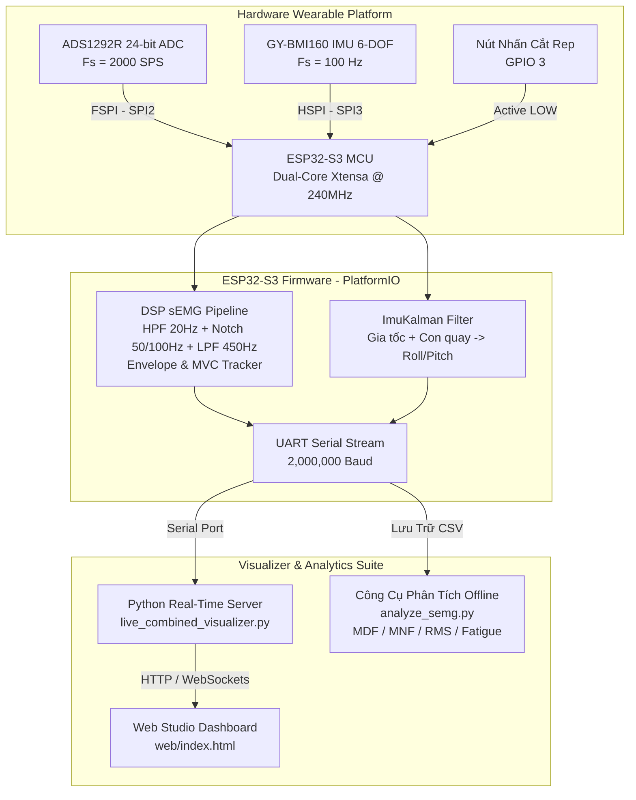

# Hệ Thống Thiết Bị Đeo Thu Thập & Phân Tích Đồng Thời Điện Cơ Sinh Học (sEMG) và Chuyển Động (IMU)
### *sEMG & 6-DOF IMU Wearable Platform for Muscle Activity and Fatigue Analysis*

Hệ thống thiết bị đeo nhúng thông minh tích hợp trên vi điều khiển **ESP32-S3**, cho phép thu thập đồng bộ thời gian thực tín hiệu **Điện cơ sinh học (sEMG)** với tốc độ cao (2000 SPS) và tín hiệu **Cử động quán tính 6 trục (IMU)** (100 Hz) qua một cổng kết nối duy nhất (UART 2,000,000 baud), phục vụ nghiên cứu y sinh, theo dõi phục hồi chức năng và phân tích mỏi cơ bắp theo chuẩn quốc tế **SENIAM / ISEK**.

---

## 📑 Mục Lục
- [1. Tính Năng Nổi Bật](#1-tính-năng-nổi-bật)
- [2. Kiến Trúc Hệ Thống](#2-kiến-trúc-hệ-thống)
- [3. Sơ Đồ Đấu Dây Phần Cứng (Pinout)](#3-sơ-đồ-đấu-dây-phần-cứng-pinout)
- [4. Chi Tiết Xử Lý Tín Hiệu (DSP & Algorithms)](#4-chi-tiết-xử-lý-tín-hiệu-dsp--algorithms)
- [5. Hướng Dẫn Cài Đặt & Sử Dụng](#5-hướng-dẫn-cài-đặt--sử-dụng)
- [6. Giao Thức Truyền Dữ Liệu Serial (Protocol)](#6-giao-thức-truyền-dữ-liệu-serial-protocol)
- [7. Công Cụ Phân Tích Mỏi Cơ Offline](#7-công-cụ-phân-tích-mỏi-cơ-offline)
- [8. Cấu Trúc Thư Mục Dự Án](#8-cấu-trúc-thư-mục-dự-án)

---

## 1. Tính Năng Nổi Bật

- **Dual-Sensor Trên 1 Board ESP32-S3**: Điều khiển độc lập hai bus phần cứng:
  - **ADS1292R** (24-bit ADC chuyên dụng cho điện sinh học) qua **FSPI (SPI2)** với tốc độ lấy mẫu **2000 SPS**.
  - **GY-BMI160** (IMU 6 trục: Gia tốc $\pm 4g$ + Con quay hồi chuyển $\pm 500^\circ/\text{s}$) qua **HSPI (SPI3)** với tần số **100 Hz**.
- **Đồng Bộ Dòng Dữ Liệu Qua 1 Cổng Serial**: Tốc độ Baudrate cực cao **2,000,000 bps (2M baud)**, tối ưu buffer 16KB chống tràn (zero packet loss).
- **Lọc Số DSP Thời Gian Thực Theo Chuẩn SENIAM**:
  - High-Pass Filter 20 Hz (loại bỏ rung lắc cơ, baseline wander).
  - Notch Filter 50 Hz & 100 Hz (triệt tiêu dải nhiễu điện lưới xoay chiều).
  - Low-Pass Filter 450 Hz (giữ trọn dải phổ sinh học cơ bắp 20 - 450 Hz).
  - Thuật toán Envelope (Moving Absolute Mean) & ước lượng co cơ theo % MVC (Maximum Voluntary Contraction).
  - Tự động nhận diện kênh đo sEMG biên độ cao nhất.
- **Bộ Lọc Kalman Kết Hợp Cử Động 6-DOF**: Ước lượng góc nghiêng Roll và Pitch chính xác, chống trôi (drift rejection), tự động nhận biết trạng thái tin cậy gia tốc.
- **Nút Nhấn Đánh Dấu Sự Kiện / Mốc Lặp (Rep Marker)**: Hỗ trợ gắn nhãn tự động cho bài toán nhận dạng cử động và cắt chu kỳ bài tập (Repetition segmentation).
- **Hệ Sinh Thái Giám Sát Real-Time Đa Nền Tảng**:
  - **Web Studio (HTML5 Canvas + Web Serial/WebSockets)**: Hiển thị trực tiếp dao động ký (Oscilloscope), thanh đo lực cơ, mô hình 3D góc nghiêng và xuất CSV.
  - **Python Studio (`live_combined_visualizer.py`)**: Tự động nhận diện cổng COM, phân luồng giải mã dữ liệu song song và giảm tải hiển thị (Decimation bucket).

---

## 2. Kiến Trúc Hệ Thống



---

## 3. Sơ Đồ Đấu Dây Phần Cứng (Pinout)

Sử dụng board **ESP32-S3** (khuyên dùng các dòng hỗ trợ chân linh hoạt như `4d_systems_esp32s3_gen4_r8n16` hoặc ESP32-S3 DevKit-C). Cấp nguồn **3.3V** sạch để đảm bảo SNR cho tín hiệu y sinh.

| Cảm Biến | Tên Chân Module | Chân Nối ESP32-S3 | Chức Năng / Ghi Chú |
| :--- | :--- | :--- | :--- |
| **ADS1292R (sEMG)** | **CS** | **GPIO 10** | Chip Select FSPI (Active LOW) |
| | **SCK / SCLK** | **GPIO 12** | SPI Clock FSPI |
| | **MOSI / DIN** | **GPIO 11** | SPI Data Input FSPI |
| | **MISO / DOUT** | **GPIO 13** | SPI Data Output FSPI |
| | **DRDY** | **GPIO 4** | Data Ready (Ngắt báo mẫu 2000 SPS) |
| | **START** | **GPIO 8** | Bắt đầu chuyển đổi ADC |
| | **PWDN / RST** | **GPIO 9** | Reset phần cứng chip ADS |
| | **3V3 & GND** | **3.3V & GND** | Nguồn ổn áp & chung Mass |
| **GY-BMI160 (IMU)** | **CS / CSB** | **GPIO 15** | Chip Select HSPI |
| | **SCK / SCL** | **GPIO 6** | SPI Clock HSPI |
| | **MOSI / SDA** | **GPIO 5** | SPI Data Input HSPI |
| | **MISO / SDO** | **GPIO 7** | SPI Data Output HSPI |
| | **3V3 & GND** | **3.3V & GND** | Nguồn 3.3V và chung Mass |
| **Nút Nhấn Sự Kiện**| **BTN** | **GPIO 3** | Nối vào GND khi nhấn (Internal Pull-Up) |

> [!WARNING]
> Không cấp nguồn 5V trực tiếp vào các chân tín hiệu của ADS1292R và BMI160. Đảm bảo toàn bộ dây nối SPI ngắn gọn, bọc chống nhiễu nếu có thể để giảm thiểu nhiễu 50Hz từ môi trường.

---

## 4. Chi Tiết Xử Lý Tín Hiệu (DSP & Algorithms)

### 4.1. Chuẩn Hóa Lọc Tín Hiệu Điện Cơ (sEMG)
1. **Khử Offset một chiều & Nhiễu vận động (HPF 20 Hz)**: Lọc IIR bậc 2 triệt tiêu thành phần trôi baseline và điện cực trượt trên da.
2. **Triệt tiêu nhiễu điện lưới (Notch Filter 50 Hz & 100 Hz)**: Bộ lọc Q-factor cao dập tắt hài 50 Hz và 100 Hz mà không làm méo phổ tần số cơ lân cận.
3. **Chống gập phổ (LPF 450 Hz)**: Giới hạn biên tần số theo khuyến nghị của SENIAM (20–450 Hz).
4. **Trích xuất bao hình động (Envelope Tracking)**: Chỉnh lưu toàn sóng kết hợp bộ lọc trung bình trượt bất đối xứng (Attack $\alpha = 0.05$, Decay $\alpha = 0.005$) cho phản hồi co cơ tức thì.
5. **Cơ chế Thích ứng Ngưỡng Nhiễu & MVC**: Theo dõi mức độ co cơ tương đối (% MVC) với 4 mức trạng thái: *THẢ LỎNG*, *GỒNG NHẸ*, *GỒNG VỪA*, *GỒNG MẠNH!*.

### 4.2. Bộ Lọc Kalman Cho Cử Động 6 Trục (IMU)
- Kết hợp gia tốc trọng trường $a_x, a_y, a_z$ và vận tốc góc gyro $\omega_x, \omega_y, \omega_z$.
- Tự động phát hiện điều kiện gia tốc đáng tin cậy ($\|a\| \approx 1g$) để hiệu chỉnh sai số trôi của con quay hồi chuyển, cho kết quả góc Roll và Pitch mượt mà ở tần số 100 Hz.

---

## 5. Hướng Dẫn Cài Đặt & Sử Dụng

### 5.1. Yêu Cầu Môi Trường
- [PlatformIO Core](https://platformio.org/) (hoặc tiện ích mở rộng PlatformIO trong VS Code).
- [Python 3.8+](https://www.python.org/) với các thư viện:
  ```bash
  pip install pyserial numpy matplotlib scipy
  ```

### 5.2. Biên Dịch & Nạp Firmware Lên ESP32-S3
Mở thư mục dự án và thực thi lệnh nạp:
```powershell
# Biên dịch mã nguồn firmware
pio run

# Nạp vào board ESP32-S3 (thêm --upload-port COMx nếu cần)
pio run -t upload

# Theo dõi trực tiếp qua Terminal (2,000,000 baud)
pio device monitor
```

### 5.3. Khởi Chạy Bộ Giám Sát Trực Quan (Live Visualizer)
Chạy script Python để tự động kết nối cổng COM và mở Web Dashboard trên trình duyệt:
```powershell
python live_combined_visualizer.py
```
- Server web sẽ tự động mở tại: `http://localhost:8765/`
- Giao diện cung cấp:
  - **Oscilloscope sEMG**: Biểu đồ tín hiệu thô (Raw ADC), tín hiệu đã lọc (Filtered) và Bao hình (Envelope).
  - **Thanh đo % Lực co cơ**: Phản hồi trực quan cường độ cơ bắp.
  - **Biểu đồ IMU**: Gia tốc $X, Y, Z$, Vận tốc góc và Góc nghiêng Roll / Pitch.
  - **Trạng thái Nút bấm (Rep Marker)**: Cắt mốc cử động chính xác từng mili-giây.
  - **Ghi dữ liệu CSV**: Xuất dữ liệu đồng bộ cho huấn luyện mô hình Machine Learning.

### 5.4. Các Phím Lệnh Tương Tác Qua Serial
Khi đang kết nối, bạn có thể gửi trực tiếp các ký tự lệnh từ Serial Monitor hoặc giao diện:
- `c`: Hiệu chuẩn lại baseline (Calibration reset).
- `f`: Bật/Tắt bộ lọc số DSP trên chip.
- `+` / `-`: Tăng / Giảm độ nhạy đo sEMG.
- `k`: Khởi tạo lại bộ lọc Kalman IMU.
- `s`: In trạng thái kết nối và số lượng mẫu.
- `r`: Khởi động lại toàn bộ cảm biến (Soft reconnect).

---

## 6. Giao Thức Truyền Dữ Liệu Serial (Protocol)

Cả 2 dòng dữ liệu được truyền xen kẽ liên tục trên cùng 1 luồng UART ở tốc độ **2,000,000 bps**:

### 6.1. Gói Dữ Liệu sEMG (Tần số 2000 SPS)
Bắt đầu bằng tiền tố định dạng `$D`:
```text
$D,<sampleCount>,<timestampUs>,<ch1Raw>,<ch2Raw>,<emgRaw16>,<emgFiltered16>,<leadOffStatus>
```
*Ví dụ:*
```text
$D,12045,6022500,1024,45120,352,298,0
```

### 6.2. Gói Dữ Liệu IMU BMI160 (Tần số 100 Hz)
Định dạng 29 trường giá trị cách nhau bằng dấu phẩy:
```text
<session>,<sequence>,<timestampUs>,<sensorTime>,<accX>,<accY>,<accZ>,<gyrX>,<gyrY>,<gyrZ>,<accX_g>,<accY_g>,<accZ_g>,<gyrX_dps>,<gyrY_dps>,<gyrZ_dps>,<tempC>,<kAccX>,<kAccY>,<kAccZ>,<kGyrX>,<kGyrY>,<kGyrZ>,<rollAccel>,<pitchAccel>,<rollKalman>,<pitchKalman>,<trusted>,<btnPressed>
```

---

## 7. Công Cụ Phân Tích Mỏi Cơ Offline

Dự án cung cấp công cụ phân tích khoa học `analyze_semg.py` xử lý các tệp CSV đã ghi:
```powershell
python analyze_semg.py path/to/semg_data.csv
```

### Các Đặc Trưng Được Trích Xuất:
1. **Lọc Hai Chiều Không Lệch Pha (Zero-Phase FiltFilt)**: Giữ nguyên hình thái sóng điện cơ tự nhiên.
2. **Đặc trưng miền thời gian (Time-Domain)**:
   - Root Mean Square (**RMS**)
   - Mean Absolute Value (**MAV**)
   - Waveform Length (**WL**)
   - Zero Crossings (**ZC**) & Slope Sign Changes (**SSC**)
3. **Đặc trưng miền tần số & Đánh giá Mỏi cơ (Frequency-Domain & Fatigue Tracking)**:
   - Mật độ phổ công suất (**PSD**)
   - Tần số trung vị (**MDF - Median Frequency**): Tiêu chuẩn vàng phát hiện mỏi cơ khi MDF có xu hướng dốc xuống theo thời gian.
   - Tần số trung bình (**MNF - Mean Frequency**).

---

## 8. Cấu Trúc Thư Mục Dự Án

```text
sEMG_FCF_Wearable/
├── include/                     # Header files cấu hình & thuật toán
│   ├── ADS1292R.h               # Định nghĩa thanh ghi & hàm ADS1292R
│   ├── BMI160.h                 # Driver SPI cho cảm biến BMI160
│   ├── ImuKalman.h              # Thuật toán lọc Kalman 6-DOF
│   ├── DebouncedButton.h        # Chống rung phím mốc Rep
│   └── ecgRespirationAlgo.h     # Thuật toán bổ trợ sinh học
├── lib/
│   └── Ads1292R/                # Thư viện giao tiếp ADS1292R SPI
│       └── protocentralAds1292r.cpp
├── src/
│   ├── main.cpp                 # Firmware chính: Tích hợp Dual-Sensor & Serial 2M baud
│   └── BMI160.cpp               # Cài đặt giao thức SPI BMI160
├── web/                         # Dual-Sensor Web Studio Dashboard
│   ├── index.html               # Giao diện chính theo dõi sEMG & IMU
│   ├── style.css                # Giao diện Dark-mode cao cấp
│   ├── app.mjs                  # Logic xử lý đồ thị & kết nối Serial
│   ├── ads.mjs                  # Xử lý hiển thị oscilloscope sEMG
│   └── protocol.mjs             # Bộ phân tích giao thức khung truyền
├── live_combined_visualizer.py  # Python Server thu thập và hiển thị thời gian thực
├── analyze_semg.py              # Pipeline phân tích mỏi cơ & trích xuất đặc trưng offline
├── platformio.ini               # Cấu hình biên dịch PlatformIO cho ESP32-S3
└── README.md                    # Tài liệu hướng dẫn dự án
```

---

## 👥 Đóng Góp & Phát Triển
Dự án được xây dựng phục vụ các ứng dụng y sinh, thể thao thông minh và giao tiếp người - máy (HMI). Mọi đóng góp, báo lỗi hoặc yêu cầu tính năng mới đều được hoan nghênh thông qua GitHub Issues và Pull Requests!