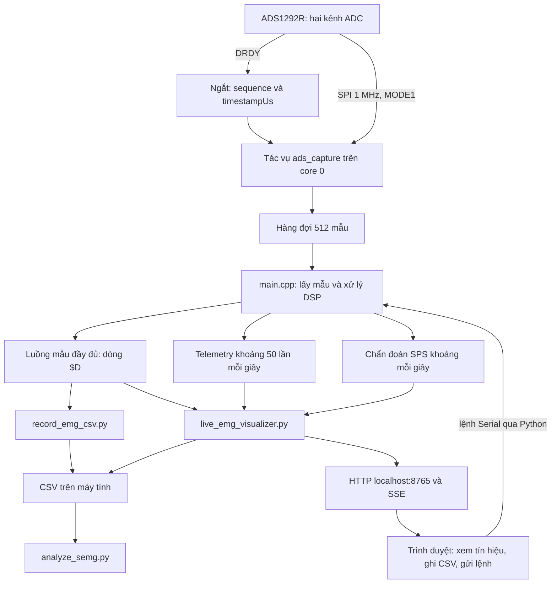
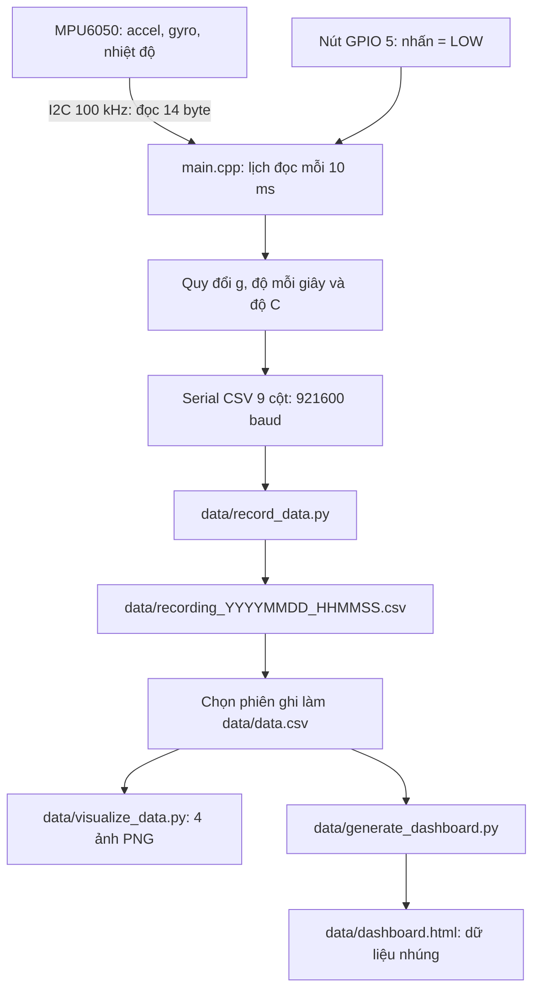

# Tổng hợp project sEMG: những phần đã làm và lý do tồn tại

Ngày tổng hợp và bổ sung: **02/10/2026**. Tài liệu gộp kết quả đọc hai nhánh:

| Phần | Nhánh / commit được đọc | Nội dung chính |
| --- | --- | --- |
| [A — ADS1292R](#phan-a-ads) | `binhdev-ads` / `f7ecb98` — `update data collecting` | Thu sEMG, DSP, `SampleAcquisition`, recorder và live visualizer |
| [B — MPU6050](#phan-b-mpu) | `dev-mpu` / `d2aaa81` — `finished visualization` | Thu chuyển động, nút bấm, CSV, ảnh PNG và dashboard IMU |
| [C — Đối chiếu](#phan-c-so-sanh) | Hai phiên bản trên | Phần dùng chung, khác biệt và thứ tự đọc |

**Checkout hiện tại đã chuyển lại về `binhdev-ads` theo yêu cầu ngày 02/10/2026.** Các cụm “hiện tại”, “đang dùng” trong mỗi phần nói về phiên bản của chính phần đó. Đây là hai luồng firmware khác nhau; chưa có chương trình thu MPU6050 và ADS1292R đồng thời trong hai phiên bản được đọc.

Đường dẫn file luôn được hiểu theo nhánh của phần đang đọc. Link đến file dùng chung mở phiên bản đang checkout; nội dung `src/main.cpp`, `platformio.ini`, `README.md` và `data/record_data.py` khác nhau giữa hai nhánh. File chỉ có ở nhánh ADS được ghi dưới dạng đường dẫn. Có thể đọc chúng mà không chuyển nhánh bằng `git show binhdev-ads:src/SampleAcquisition.cpp`; tương tự dùng `git show dev-mpu:src/main.cpp` để xem firmware MPU.

Tài liệu giải thích project từ mã nguồn, cấu hình, kiểm thử và lịch sử Git tại máy. Các lý do thiết kế được đối chiếu với cách code hoạt động; phần nào suy ra từ chức năng sẽ được trình bày như mục đích kỹ thuật, không coi đó là lời xác nhận của tác giả. Dữ liệu CSV, HTML được tạo sẵn, ảnh và log được xem xét về cấu trúc và vai trò. Thư viện tải về trong `.pio`, cache và sản phẩm build không được xem là phần chức năng tự viết của project.

<a id="phan-a-ads"></a>

# Phần A — Nhánh `binhdev-ads`: ESP32-S3 + ADS1292R

## 1. Project đang làm được gì?

Project hiện có một luồng thu tín hiệu điện cơ bề mặt bằng **ESP32-S3 + ADS1292R**, xử lý tín hiệu ngay trên ESP32, gửi dữ liệu sang máy tính, ghi CSV và hiển thị trên trình duyệt. Tần số ADC được cấu hình là **2000 mẫu/giây**; công cụ Python có cơ chế đo tốc độ nhận thực tế và phát hiện khoảng trống số thứ tự mẫu.

Các chức năng đã có trong code:

| Phần đã triển khai | Vì sao cần nó? | Nơi thực hiện |
| --- | --- | --- |
| Giao tiếp SPI, reset và cấu hình ADS1292R | ESP32 cần thiết lập chip, kiểm tra kết nối và đọc dữ liệu ADC | `src/main.cpp`, `lib/Ads1292R/protocentralAds1292r.*` |
| Đọc hai kênh có dấu 24 bit | Giữ dữ liệu ADC gốc để xem lại và xử lý theo nhiều cách | Driver ProtoCentral và `SampleAcquisition` |
| Ngắt DRDY, tác vụ thu mẫu riêng và hàng đợi | Việc lọc hoặc gửi Serial có thể chậm; cần tách chúng khỏi việc đọc ADC | `src/SampleAcquisition.cpp` |
| Timestamp, số thứ tự và bộ đếm mất mẫu | Biết mẫu được lấy khi nào và dữ liệu có liên tục hay không | `SampleAcquisition`, `sample_timing.py` |
| Chuỗi lọc điện cơ bốn tầng | Giảm thành phần DC, nhiễu chậm, điện lưới và nhiễu ngoài dải mục tiêu | `src/main.cpp` |
| Envelope, mức nghỉ, ngưỡng nhiễu và phần trăm kích hoạt | Biến sóng điện cơ dao động nhanh thành tín hiệu dễ quan sát khi gồng/nhả | `src/main.cpp` |
| Ghi CSV tốc độ cao | Lưu từng mẫu nhận được để phân tích sau | `record_emg_csv.py`, `live_emg_visualizer.py` |
| Hiển thị trực tiếp và gửi lệnh từ trình duyệt | Quan sát tín hiệu, điều chỉnh độ nhạy và ghi dữ liệu thuận tiện | `live_emg_visualizer.py` |
| Lọc và trích xuất đặc trưng sau khi ghi | Xem lại dữ liệu gốc, tính RMS/MAV/WL/ZC/SSC/SSI và MDF/MNF | `analyze_semg.py` |
| Phân tích dữ liệu MPU6050 của giai đoạn trước | Xem gia tốc, vận tốc góc, nhiệt độ và sự kiện nút bấm | Các công cụ IMU trong `data/` |
| Kiểm thử tốc độ, mất mẫu, tràn bộ đếm và recorder | Kiểm tra logic thu dữ liệu trên máy tính mà không cần ESP32 | `test/test_sample_timing.py`, `test/test_recorder.py` |

Mức triển khai hiện tại là hệ thống thu, xử lý và quan sát dữ liệu. Trong nhánh này, các thư mục `models/`, `features/`, `preprocessing/` và `evaluation/` mới có `.gitkeep`; chưa có pipeline huấn luyện, model đã huấn luyện hoặc đánh giá mô hình nằm trong các thư mục đó.

## 2. Project đã phát triển qua những giai đoạn nào?

Các mốc dưới đây lấy từ lịch sử Git của nhánh đang đọc. Chúng giúp giải thích vì sao repo có cả công cụ MPU6050 lẫn ADS1292R.

| Mốc / commit | Thay đổi được ghi nhận | Ý nghĩa trong project |
| --- | --- | --- |
| `a570107`, 10/08/2026 | Tạo cấu trúc thư mục | Chuẩn bị nơi chứa firmware, dữ liệu, đặc trưng, model và đánh giá |
| `e615b38`, 20/08/2026 | Cấu hình ESP32-S3 đọc MPU6050 | Bắt đầu luồng thu dữ liệu chuyển động |
| `e1d2351`, 22/08/2026 | Cập nhật nút bấm và hàm thu dữ liệu | Thêm dấu mốc thủ công để đối chiếu tín hiệu với thao tác |
| `7383876` đến `d2aaa81`, 25–27/08/2026 | Xử lý dữ liệu, sửa và hoàn thiện trực quan hóa | Hình thành bộ công cụ CSV, biểu đồ PNG và dashboard IMU |
| `5fb7038`, 03/09/2026 | Thêm driver ADS1292R dạng lớp riêng | Có API cấu hình ADC, đọc hai kênh và quy đổi điện áp |
| `631b758`, 28/09/2026 | Thêm thư viện ADS1292R và tích hợp SPI vào `main` | Chuyển luồng firmware sang chip đo điện thế sinh học |
| `5dba780`, 28/09/2026 | Lọc sEMG, đọc hai kênh và web visualizer | Có đường xử lý tín hiệu và quan sát điện cơ trực tiếp |
| `2eef536`, 30/09/2026 | Nâng cấu hình lên 2000 SPS, bộ lọc mục tiêu 20–450 Hz, phân tích offline | Giữ thêm dữ liệu gốc và mở rộng công cụ phân tích điện cơ |
| `f7ecb98`, 01/10/2026 | Cải tiến thu dữ liệu | Thêm `SampleAcquisition`, recorder riêng, `SampleClock`, kiểm thử; tăng Serial lên 2 Mbaud và đo mất mẫu rõ hơn |

Ở thời điểm đọc nhánh ADS, `binhdev-ads` hơn upstream được lưu tại máy một commit. Đây là trạng thái so với thông tin tracking local, không phải một lần kiểm tra GitHub mới. Phần A mô tả `binhdev-ads`; các thao tác khôi phục `binhdev` ở phiên làm việc trước thuộc một nhánh khác. Nhánh `dev-mpu` được trình bày riêng trong phần B.

## 3. Luồng dữ liệu tổng thể



Có ba mức dữ liệu khác nhau:

- **Dòng `$D`** mang dữ liệu từng mẫu ADC đã đọc và đưa qua hàng đợi thành công. Mục tiêu là thu đủ 2000 mẫu/giây.
- **Telemetry `Raw: ... | Filt: ... | Env: ...`** được gửi khoảng mỗi 20 ms để cập nhật giao diện. Nó chứa kết quả mới nhất và trạng thái gồng/nhả.
- **Dòng `[SPS]`** báo tốc độ DRDY, tốc độ đọc và số mẫu mất đã ghi nhận.

Việc đặt ba luồng này riêng giúp giữ dữ liệu đầy đủ cho CSV trong khi giao diện có nhịp cập nhật phù hợp để hiển thị.

## 4. Bản đồ file: file nào để làm gì và vì sao có nó?

### Firmware, driver và cấu hình

| File | Nội dung / lý do tồn tại | Trạng thái ở nhánh hiện tại |
| --- | --- | --- |
| [src/main.cpp](../src/main.cpp) | Điểm vào của chương trình Arduino: khởi tạo ADS, xử lý mẫu, lọc tín hiệu, tính envelope, gửi Serial và nhận lệnh | Đang chạy |
| `include/SampleAcquisition.h` | Định nghĩa `AcquiredSample`, `AcquisitionStats` và API chung để `main` dùng bộ thu mẫu | Đang dùng |
| `src/SampleAcquisition.cpp` | Ngắt DRDY, tác vụ FreeRTOS, hàng đợi mẫu, khóa SPI và thống kê thu mẫu | Đang chạy |
| `lib/Ads1292R/protocentralAds1292r.h` | Địa chỉ thanh ghi, lệnh ADS, cấu trúc kết quả và API giao tiếp | Đang dùng |
| `lib/Ads1292R/protocentralAds1292r.cpp` | Thực hiện giao dịch SPI, cấu hình chip, giải mã mẫu 24 bit và đọc status | Driver được `main` và bộ thu mẫu gọi |
| `include/ADS1292R.h`, `src/ADS1292R.cpp` | Driver dạng lớp riêng: cấu hình tốc độ/gain/input, đọc mẫu, quy đổi mV, tùy chọn clock ngoài và tín hiệu test | Được build vì nằm trong `src`, nhưng `main` hiện không tạo hay gọi lớp này |
| `lib/Ads1292R/ecgRespirationAlgo.h`, `lib/Ads1292R/ecgRespirationAlgo.cpp` | Thuật toán FIR, QRS/nhịp tim và nhịp thở đi cùng thư viện gốc | Header được include; luồng sEMG hiện không gọi các thuật toán này |
| [include/KalmanFilter.h](../include/KalmanFilter.h) | Kalman hai trạng thái cho góc/bias gyro và Kalman một chiều để làm mượt | Có sẵn cho xử lý IMU; firmware ADS hiện không gọi |
| [platformio.ini](../platformio.ini) | Chọn board, Arduino, tốc độ monitor, bộ lọc log và build flags | Cấu hình build hiện tại |

Hai driver ADS tồn tại do các giai đoạn tích hợp khác nhau trong lịch sử repo. Khi đọc code hiện tại, cần theo đường gọi `ads1292r` trong thư viện ProtoCentral: cấu hình mặc định 500 SPS/gain 6 của lớp `ADS1292R` riêng không phải cấu hình đang được `main` sử dụng.

### Công cụ trên máy tính

| File | Nội dung / lý do tồn tại | Trạng thái |
| --- | --- | --- |
| `record_emg_csv.py` | Ghi riêng luồng `$D` ra CSV, đo SPS/mất mẫu, đóng phiên nếu ESP32 restart | Phù hợp với firmware hiện tại |
| `sample_timing.py` | Logic đo thời gian, SPS, mất mẫu, wrap và restart dùng chung | Recorder và live visualizer đều gọi |
| `live_emg_visualizer.py` | Đọc Serial, đo chất lượng dữ liệu, ghi CSV, phục vụ HTML/SSE và chuyển lệnh đến ESP32 | Công cụ xem và ghi trực tiếp hiện tại |
| `analyze_semg.py` | Đọc CSV sEMG, lọc lại kênh 2, tính đặc trưng và diễn biến MDF/MNF; xuất CSV đã lọc | Có triển khai; còn các giới hạn ở mục 10 |
| [data/record_data.py](../data/record_data.py) | Wrapper gọi `record_emg_csv.py` ở thư mục gốc | Giữ đường chạy cũ trong `data/` tương thích với recorder mới |
| `data/generate_emg_dashboard.py` | Tìm CSV, in thống kê biên độ/RMS rồi mở `emg_dashboard.html` | Công cụ theo schema CSV cũ; không tự sinh lại HTML từ CSV mới |
| `data/emg_dashboard.html` | Dashboard sEMG tĩnh: nạp CSV thủ công, dữ liệu demo, RMS, phổ và sự kiện nút | Parser CSV chưa khớp recorder hiện tại |
| [data/generate_dashboard.py](../data/generate_dashboard.py) | Đọc `data.csv` IMU, tính thống kê/sự kiện, nhúng dữ liệu vào HTML Plotly | Công cụ MPU6050 giữ lại từ trước |
| [data/dashboard.html](../data/dashboard.html) | Bản dashboard IMU đã tạo: trục XYZ, tổng quan, 3D, phổ, zoom và xem sự kiện | File đầu ra để mở xem |
| [data/visualize_data.py](../data/visualize_data.py) | Vẽ các biểu đồ IMU bằng Matplotlib | Công cụ tạo ảnh cho dữ liệu IMU |

### Dữ liệu, kiểm thử và các file hỗ trợ

| File / thư mục | Vai trò và lý do tồn tại |
| --- | --- |
| `data/data.csv` | Dữ liệu IMU local: timestamp ms, gia tốc XYZ, gyro XYZ, nhiệt độ và nút bấm; làm đầu vào cho công cụ IMU |
| `data/plot_axes_xyz_breakdown.png` | Ảnh so sánh gia tốc và gyro theo từng trục, kèm nút bấm |
| `data/plot_sensor_overview.png` | Ảnh tổng quan các tín hiệu theo thời gian |
| `data/plot_distributions_correlation.png` | Ảnh phân bố, tương quan và đối chiếu theo nút bấm |
| `data/plot_3d_trajectory_fft.png` | Ảnh biểu diễn vector gia tốc trong không gian 3D và phổ tần số; vector gia tốc này chưa phải quỹ đạo vị trí tích phân |
| `logs/device-monitor-*.log` | Lịch sử Serial Monitor dùng kiểm tra boot, kết nối và giá trị tín hiệu; có các file rỗng |
| `test/test_sample_timing.py` | Kiểm tra tốc độ đủ mẫu, thiếu mẫu, wrap 32 bit, restart và mẫu trùng |
| `test/test_recorder.py` | Dùng Serial giả để kiểm tra ghi CSV, telemetry xen kẽ, thời gian tương đối và đóng phiên khi restart |
| [README.md](../README.md) | Hướng dẫn đấu dây, bố trí điện cực và chạy thu dữ liệu; là tài liệu vận hành hiện có |
| `include/README`, `lib/README`, `lib/Ads1292R/README`, `test/README` | Tài liệu mẫu của PlatformIO về cấu trúc thư mục; chưa phải mô tả riêng đầy đủ cho module ADS |
| [.gitignore](../.gitignore) | Bỏ qua `.pio`, một số file VS Code, bytecode Python và `data/*.csv`, tránh đưa dữ liệu local/sản phẩm build vào Git |
| `.vscode/extensions.json` | Gợi ý extension PlatformIO cho VS Code |
| `compile_commands.json` | Danh sách lệnh biên dịch cho công cụ phân tích C/C++/IDE; chứa đường dẫn theo môi trường máy |
| `.vscode/c_cpp_properties.json`, `.vscode/launch.json` | Cấu hình hỗ trợ code completion và debug tại máy, đang được Git bỏ qua |
| `.pio/` | Dependency, object, ELF/BIN và metadata do PlatformIO sinh ra |
| `.cache/clangd/`, `__pycache__/` | Cache phân tích mã và bytecode; hỗ trợ tốc độ công cụ |
| `firmware/`, `features/`, `models/`, `preprocessing/`, `evaluation/`, các `.gitkeep` | Khung thư mục dự phòng. Firmware chạy thực tế nằm trong `src/`; các thư mục trên hiện mới là chỗ giữ cấu trúc |
| `docs/` | Nơi lưu tài liệu project, gồm bản tổng hợp này |

## 5. Vì sao cần `SampleAcquisition`?

Trước commit `f7ecb98`, `loop()` tự đọc ADC, xử lý lọc, tính trạng thái rồi gửi Serial. Nếu `Serial.printf()` hoặc các thao tác khác mất thời gian, vòng lặp có thể quay lại đọc ADC muộn. Tăng cấu hình ADC lên 2000 SPS chỉ khiến chip tạo mẫu nhanh hơn; vẫn cần chứng minh phần mềm đọc và truyền đủ mẫu.

`SampleAcquisition` giải quyết việc này bằng cách đặt công việc đọc ADC vào một tác vụ riêng.

### Cách nó hoạt động

1. `beginAcquisition()` tạo hàng đợi 512 mẫu, mutex SPI và tác vụ `ads_capture` trên core 0, priority 3, stack 4096 byte.
2. Tác vụ cài ngắt cạnh xuống trên DRDY. Mỗi ngắt, `onDataReady()` tăng `edgeSequence`, ghi thời điểm `esp_timer_get_time()` vào `timestampUs`, rồi đánh thức tác vụ đọc.
3. Tác vụ lấy sequence/timestamp mới nhất, đọc một frame ADC qua SPI và kiểm tra kết quả.
4. Nếu nhiều cạnh DRDY đã xảy ra trước khi được xử lý, tác vụ tính số mẫu bỏ qua. Nếu đọc thất bại hoặc có cạnh mới trong khi truyền SPI, frame đó bị xem là không hợp lệ.
5. Mẫu hợp lệ được đưa vào queue bằng thao tác không chờ. Nếu queue đầy, tăng `queueDrops` thay vì chặn công việc đọc ADC.
6. `main.cpp` gọi `receiveSample()` để lấy mẫu, sau đó mới lọc và gửi Serial.

Queue 512 mẫu tương đương khoảng **256 ms** dữ liệu ở 2000 SPS. Nó hấp thụ các lần chậm ngắn ở phía xử lý. Nếu phía tiêu thụ luôn chậm hơn phía thu, queue vẫn sẽ đầy; module ghi nhận mất mẫu để người dùng thấy vấn đề đó.

### Vì sao mẫu cần các trường này?

| Trường trong `AcquiredSample` | Lý do cần |
| --- | --- |
| `sequence` | Tăng theo ngắt DRDY quan sát được, giúp nhận biết lỗ hổng số thứ tự sau này |
| `timestampUs` | Gắn thời gian trước công việc SPI/DSP/Serial, giảm sai lệch do các công việc đó |
| `ch1`, `ch2` | Giữ hai số nguyên có dấu giải mã từ ADC 24 bit |
| `leadOff` | Chuyển trạng thái được driver đọc từ status sang CSV/giao diện |

Timestamp này là thời điểm phần mềm phục vụ ngắt DRDY, vẫn chịu độ trễ ngắt. Sequence phản ánh các ngắt đã quan sát; nó không phải bộ đếm phần cứng nằm trong chip ADS.

### Vì sao cần khóa SPI?

Tác vụ thu mẫu và `main` cùng dùng bus SPI. Lệnh `r` khởi tạo lại ADC, còn `d` gọi `dumpRegisters()` để kiểm tra/ghi lại cấu hình và đọc bảng thanh ghi. Mutex ngăn hai nơi cùng gửi giao dịch vào chip. Các lệnh này vẫn làm gián đoạn thu dữ liệu; khóa giúp tuần tự hóa truy cập.

`cachedDeviceId` cũng được thêm để lệnh xem trạng thái `s` và thông báo chờ mẫu dùng ID đã lưu, giảm việc đọc thanh ghi trong lúc thu liên tục.

## 6. Cấu hình ADS và xử lý tín hiệu trong `main.cpp`

### Cấu hình đang được dùng

| Thông số | Giá trị trong code |
| --- | --- |
| Board PlatformIO | `4d_systems_esp32s3_gen4_r8n16` |
| SPI | 1 MHz, `MSBFIRST`, `SPI_MODE1` |
| CS / SCK / MOSI / MISO | GPIO 10 / 12 / 11 / 13 |
| PWDN / START / DRDY | GPIO 9 / 8 / 4 |
| `CONFIG1` | `0x04`, cấu hình 2000 SPS |
| `CH1SET`, `CH2SET` | `0x40`, gain 4, đầu vào điện cực bình thường |
| `CONFIG2` | `0xA0`, bật reference buffer theo chú thích và cấu hình driver |
| `RLDSENS` | `0xBC`: RLD bật, lấy IN2P/IN2N; không lấy IN1P/IN1N. Bit bật RLD là bit 5, không phải bit 7 như chú thích code |
| `RESP1`, `RESP2` | `0x02`, `0x03` |
| Serial / Python / Monitor | 2.000.000 baud |
| Bộ đệm phát Serial | 8192 byte |
| USB CDC on boot | Tắt qua build flag |

Các giá trị thanh ghi trên được ghi khi init và được kiểm tra lại trong `dumpRegisters()`. Đây là cấu hình mã nguồn; sự phù hợp với board/module thực tế vẫn cần đối chiếu phần cứng sử dụng. Phần giải mã RLD đã được kiểm tra lại theo bảng 23 trong [datasheet TI ADS1292R](https://www.ti.com/lit/ds/symlink/ads1292r.pdf): chú thích “bit 7 bật RLD / lấy cả Ch1 & Ch2” trong firmware hiện sai. Điều này chưa tự chứng minh cấu hình thực tế gây nhiễu; cần biết kênh và điện cực đang được đấu.

### Tại sao lưu 24 bit nhưng lọc trên thang 16 bit?

Firmware giữ nguyên `ch1_raw24`, `ch2_raw24` cho dataset. Nhánh xử lý trực tiếp dùng `ch2_raw24 >> 8` để có thang số nhỏ hơn cho lọc và hiển thị. Đây là dịch bit/lược bỏ 8 bit thấp, không phải thay đổi độ phân giải ADC hay phép đo đã hiệu chuẩn sang mV.

Kênh 2 được chọn cố định làm đầu vào sEMG chính. Cách chọn cố định giúp tránh việc chuyển qua lại giữa hai tín hiệu khi biên độ của chúng đổi thứ tự. Kênh 1 vẫn được lưu trong CSV để xem lại.

### Các bước xử lý và lý do

| Bước | Chức năng dự định trong code |
| --- | --- |
| High-pass mang tên 20 Hz | Giảm DC và thành phần thay đổi chậm |
| Notch mang tên 50 Hz | Giảm thành phần điện lưới tại tần số mục tiêu |
| Notch mang tên 100 Hz | Giảm thành phần hài tại tần số mục tiêu |
| Low-pass mang tên 450 Hz | Giảm thành phần ngoài dải điện cơ mục tiêu |
| `fabsf()` + lọc mượt envelope | Chuyển tín hiệu dao động thành biên độ hoạt động dễ theo dõi; hệ số hiện tại tương ứng hằng số thời gian khoảng 75 ms ở 2000 SPS |
| Baseline tự thích ứng | Theo dõi mức tín hiệu khi nghỉ |
| Noise gate | Giảm dao động nhỏ quanh mức nghỉ khi hiển thị phần trăm |
| Peak tự thích ứng và sensitivity | Điều chỉnh dải hiển thị khi mức co cơ/biên độ thay đổi |
| Chặn phần trăm 0–100 và phân nhóm | Cho giao diện các trạng thái thả lỏng, gồng nhẹ, vừa, mạnh |

Tên tần số và mô tả “SENIAM” trong code thể hiện mục tiêu thiết kế. Đợt đọc project này chưa đo đáp ứng tần số để xác nhận từng hệ số lọc hay chứng nhận việc tuân thủ tiêu chuẩn. Bộ lọc cũng làm thay đổi biên độ/phổ, nên các câu “bảo toàn 100%” trong chú thích không phải kết quả kiểm chứng.

`Luc: ... %` là chỉ số kích hoạt tương đối tính từ envelope, baseline, peak và sensitivity. Code chưa có hiệu chuẩn sang lực cơ theo Newton; tên `mvcPeak` hiện là đỉnh tự thích ứng, chưa thể hiện một quy trình đo MVC có chuẩn tham chiếu.

Khi tắt DSP, firmware vẫn trừ thành phần DC bám chậm trên tín hiệu thang 16 bit. Vì vậy cột kết quả xử lý ở chế độ này vẫn khác dữ liệu 24 bit gốc.

### Lệnh điều khiển

| Lệnh | Việc thực hiện / mục đích |
| --- | --- |
| `c`, `C` | Cân chỉnh baseline, peak, noise gate và đưa sensitivity về 1 |
| `f`, `F` | Bật/tắt chuỗi DSP và cân chỉnh lại |
| `+`, `=` | Tăng sensitivity bằng hệ số 1,40; giới hạn trên 50 |
| `-`, `_` | Giảm sensitivity bằng hệ số 0,70; giới hạn dưới 0,1 |
| `s`, `?` | In thông tin đang lưu về chip, DSP và cân chỉnh |
| `r`, `R` | Khởi tạo lại ADC, kiểm tra cấu hình và cân chỉnh lại |
| `d`, `D` | Kiểm tra/ghi lại cấu hình cần thiết, in thanh ghi và khởi động lại luồng đọc liên tục |

`c` thay các tham số cân chỉnh; hàm này không xóa trạng thái lịch sử `x1/x2/y1/y2` của các bộ lọc IIR.

## 7. Vì sao tăng Serial lên 2 Mbaud và thêm recorder riêng?

UART 8N1 cần khoảng 10 bit cho mỗi byte. Với 115200 baud, mức truyền lý thuyết khoảng 11.520 byte/giây; ở 2.000.000 baud, khoảng 200.000 byte/giây. Ví dụ 2000 dòng dữ liệu, mỗi dòng 74 byte, đã cần khoảng 148.000 byte/giây trước khi cộng telemetry. Điều này giải thích thay đổi tốc độ trong firmware, PlatformIO và Python ở commit `f7ecb98`.

Recorder đọc Serial theo khối để giảm số lần gọi I/O, gom các byte đến khi có ký tự xuống dòng rồi mới giải mã. Nó chỉ ghi dòng `$D` hợp lệ; các dòng trạng thái không được ghi vào bảng mẫu. Bộ đệm driver được yêu cầu tăng lên 64 KiB khi môi trường hỗ trợ, còn CSV được flush định kỳ mỗi 500 mẫu.

`record_emg_csv.py` có thể dò COM, nhận COM/baud từ tham số, chọn đường dẫn đầu ra và dừng bằng `Ctrl+C`. Khi phát hiện ESP32 restart, nó đóng phiên ghi để hai đoạn thời gian khác nhau không bị nối chung trong một CSV.

### Định dạng dữ liệu

Luồng Serial:

```text
$D,sequence,timestampUs,ch1_raw24,ch2_raw24,ch2_raw16,filtered16,leadOff
```

CSV do recorder tạo:

```text
sample_idx,timestamp_us,ch1_raw24,ch2_raw24,ch2_raw16,filtered16,lead_off,time_s
```

| Cột | Ý nghĩa |
| --- | --- |
| `sample_idx` | Sequence theo ngắt DRDY đã quan sát, có thể có khoảng trống |
| `timestamp_us` | Timestamp 32 bit tại ISR DRDY |
| `ch1_raw24`, `ch2_raw24` | Dữ liệu ADC có dấu, đơn vị count |
| `ch2_raw16` | Kênh 2 sau dịch phải 8 bit, đơn vị count |
| `filtered16` | Kết quả xử lý trên thang 16 bit, ép thành số nguyên khi truyền; không có nghĩa mọi giá trị đều bị giới hạn vào kiểu `int16_t` |
| `lead_off` | Cờ status do driver giải mã; xem giới hạn cấu hình tại mục 10 |
| `time_s` | Thời gian từ mẫu đầu phiên ghi, tính bằng timestamp ESP32 và xử lý wrap |

CSV do live visualizer ghi dùng tên `ch2_filtered16` thay cho `filtered16`; vị trí cột tương ứng hiện giống nhau. `analyze_semg.py` đọc theo vị trí cột, nên vẫn lấy được kênh 2 raw từ hai loại CSV này.

### Vì sao có `sample_timing.py`?

Máy tính có thể nhận Serial/USB theo từng đợt. Đếm số dòng trong một khoảng thời gian ngắn của máy tính có thể cho tốc độ nhảy lên xuống dù ADC đều nhịp. `SampleClock` dùng timestamp ESP32 để đo tốc độ mẫu được nhận trong cửa sổ ít nhất một giây và tính tốc độ trung bình toàn đoạn.

Nó dùng chênh lệch sequence để đếm mẫu thiếu, xử lý bộ đếm 32 bit quay vòng bằng phép toán modulo, phát hiện các bước lùi lớn như một phiên restart và từ chối sequence/timestamp trùng. Timestamp microsecond 32 bit quay vòng khoảng mỗi 71,6 phút; logic wrap giúp việc đó không tự bị xem là restart.

Khoảng trống sequence cho biết có mất mẫu trên đường từ ADC đến Python. Muốn biết mất ở bước đọc hay queue, cần đối chiếu thêm `[SPS]`; riêng khoảng trống ở CSV chưa phân biệt được mọi nguyên nhân.

## 8. Các công cụ hiển thị giải quyết nhu cầu nào?

### `live_emg_visualizer.py`

Một luồng Python đọc Serial; HTTP server phục vụ giao diện ở `http://localhost:8765`. SSE `/stream` đẩy dữ liệu cập nhật sang trình duyệt. `/cmd` chuyển phím lệnh sang Serial; `/record` bắt đầu/dừng CSV; `/reset` xóa các bộ đếm QC của giao diện.

Giao diện có đồ thị raw, filtered, envelope và baseline, phần trăm kích hoạt, các chỉ số SPS, mẫu mất, gap, clipping, lead-off và trạng thái ghi. Canvas có thang tự điều chỉnh để nhìn được tín hiệu ở các mức biên độ khác nhau. DOM cập nhật khoảng 25 lần/giây để giảm công việc giao diện.

Code gom 10 mẫu thành một bucket, chọn giá trị raw/filtered có trị tuyệt đối lớn nhất trong bucket để phục vụ preview. Tuy nhiên SSE hiện chỉ gửi snapshot mới nhất khi nhận telemetry khoảng 50 Hz; mỗi bucket không được truyền thành một điểm riêng. Vì vậy preview đã lược dữ liệu và không bảo đảm giữ mọi spike. File CSV được ghi từ luồng `$D` đầy đủ các mẫu nhận được, trước bước preview.

Mỗi client SSE có queue riêng; khi đầy, Python bỏ dữ liệu giao diện cũ để cập nhật gần thời gian hiện tại hơn. Điều này không đồng nghĩa với việc bỏ các dòng CSV.

### Các dashboard tĩnh

`data/dashboard.html` thuộc luồng IMU: có dữ liệu nhúng, Plotly, zoom đồng bộ, cửa sổ thời gian và chuyển đến sự kiện nút bấm. `data/visualize_data.py` tạo bốn ảnh PNG để xem/chèn vào báo cáo.

`data/emg_dashboard.html` thuộc phiên bản sEMG trước: dùng Chart.js, nạp CSV bằng trình duyệt, tính moving RMS, phổ và MDF/MNF, thống kê đợt co theo cột nút bấm. Khi mở trang, nó tự nạp dữ liệu mô phỏng 500 SPS. Kết quả demo là dữ liệu do trang tạo ra, không phải một phép đo phần cứng.

`data/generate_emg_dashboard.py` phân tích sơ bộ CSV rồi mở trang HTML có sẵn. File này không đưa dữ liệu CSV vừa đọc vào trang một cách tự động; người dùng vẫn nạp file trong giao diện. Công cụ Python và parser HTML đều có các giả định schema cũ được ghi ở mục 10.

## 9. Phân tích offline trong `analyze_semg.py`

Script đọc `ch2_raw24` từ CSV để lọc lại trên dữ liệu ADC gốc, tránh phụ thuộc hoàn toàn vào kết quả lọc/ép số nguyên đã gửi từ ESP32.

Các bước đã có:

1. Đọc sequence, timestamp, hai kênh raw và cờ lead-off; yêu cầu ít nhất 200 mẫu.
2. Trừ trung bình kênh 2 và chạy các bộ lọc high-pass, notch 50/100 Hz, low-pass theo mục tiêu 20–450 Hz.
3. Lọc tiến rồi lùi bằng hàm `filtfilt_iir()` tự viết.
4. Tính đặc trưng miền thời gian trên toàn tín hiệu: RMS, MAV, WL, ZC, SSC và SSI.
5. Chia cửa sổ 2000 mẫu, bước 1000 mẫu, tính phổ rời rạc trong dải 20–450 Hz để lấy MDF/MNF và RMS theo cửa sổ.
6. Hồi quy MDF theo thời gian, in nhãn dựa trên ngưỡng slope được đặt trong script.
7. Xuất file `<tên_gốc>_CLEANED_SENIAM.csv` gồm sequence, thời gian, raw kênh 2 và kết quả lọc.

RMS/MAV giúp mô tả mức biên độ; WL/ZC/SSC mô tả biến thiên của tín hiệu; MDF/MNF mô tả phân bố năng lượng theo tần số. Đây là những đại lượng có thể dùng làm đầu vào nghiên cứu tiếp theo. Comment có nhắc WAMP nhưng code hiện chưa tính WAMP. Các giá trị đặc trưng được in ra console; chưa có bảng đặc trưng theo cửa sổ được lưu thành file riêng.

## 10. Những điểm cần hiểu đúng về trạng thái hiện tại

Các điểm này được ghi từ code để phân biệt chức năng đã có với phần còn cần hoàn thiện. Đợt tổng hợp này không sửa các phần đó.

| Điểm quan sát được | Ảnh hưởng |
| --- | --- |
| Có driver ADS riêng và driver ProtoCentral cùng tồn tại | Chỉnh driver không được gọi sẽ không đổi hành vi firmware đang chạy; một số giá trị mặc định giữa hai driver khác nhau |
| `data/emg_dashboard.html` tìm `raw_ch1/raw_ch2` hoặc `ch1_mv/emg_ch1`, còn recorder mới tạo `ch1_raw24/ch2_raw24` | CSV mới không được đọc đúng biên độ; parser hiện có thể đưa kênh về 0 nếu không tìm thấy tên cột |
| Dashboard cũ và `generate_emg_dashboard.py` mặc định thời gian ms, quy đổi raw với gain 6 | CSV mới có `timestamp_us` và firmware gain 4; cần cập nhật schema, đơn vị và gain trước khi dùng để kết luận về biên độ/SPS |
| Firmware cấu hình `LOFFSENS = 0x00`, chú thích `CONFIG2` cho biết comparator lead-off tắt | Cột `lead_off` vẫn được xuất nhưng giá trị false chưa đủ chứng minh điện cực đang tiếp xúc đúng |
| Điều kiện `healthy` trong Python xét mất mẫu, SPS và lead-off | Clipping/gap có chỉ báo riêng trên UI nhưng chưa được ghép vào điều kiện `healthy`; nhãn đó phản ánh đúng tập điều kiện đang viết |
| Tác vụ đọc giữ sequence/timestamp gần nhất khi có nhiều notification | Những mẫu cũ đã bỏ lỡ không được khôi phục; queue là nơi chứa mẫu đã đọc, không phải bộ nhớ lịch sử của ADC |
| Mất mẫu đã được đếm, nhưng DSP vẫn xử lý liên tiếp các mẫu nhận được với hệ số Fs cố định | Khi có lỗ hổng, khoảng thời gian thực giữa mẫu có thể khác giả định lọc |
| `analyze_semg.py` đặt `fs = 2000`, dùng sequence/2000 cho thời gian; timestamp được đọc nhưng không dùng để dựng trục thời gian | Phân tích offline cần kiểm tra tính liên tục và tốc độ dữ liệu đầu vào; code hiện chưa xử lý gap/wrap theo cách `SampleClock` làm |
| `analyze_semg.py` đọc cờ lead-off nhưng không loại đoạn lỗi; lọc tiến/lùi tự viết chưa có xử lý biên như một triển khai thư viện đã kiểm chứng | Đặc trưng có thể chịu ảnh hưởng của đoạn tiếp xúc lỗi hoặc transient ở đầu/cuối |
| Phổ offline dùng DFT bước tần số 2 Hz và chỉ lấy mỗi mẫu thứ hai trong cửa sổ; chưa có windowing/kiểm thử phổ | MDF/MNF và nhãn mỏi hiện là kết quả thuật toán thử nghiệm, cần kiểm chứng phương pháp trước khi sử dụng như chỉ số đã xác thực |
| Vòng lặp cửa sổ dùng `range(0, N - win_len, win_step)` | File đúng 2000 mẫu chưa tạo cửa sổ phổ; cửa sổ ở đúng biên cuối cũng có thể bị bỏ |
| Ngưỡng MDF slope `-0.5 Hz/s` được đặt trực tiếp trong script | Nhãn được in theo quy tắc này; repo chưa có bộ dữ liệu đánh giá độ đúng của nhãn |
| Biến trạng thái ghi file của live visualizer dùng giữa thread HTTP và Serial | Kiểm thử hiện có chưa bao phủ thao tác bắt đầu/dừng ghi và reconnect đồng thời trong UI |
| Một số chú thích dùng khẳng định “100%”, “chuẩn”, “chính xác” | Chú thích thể hiện ý định; bằng chứng hiện có là code/build/test, chưa phải phép đo tất cả tính chất đó |
| Công cụ IMU và CSV IMU vẫn tồn tại | Firmware hiện tại không có luồng lấy mẫu MPU6050; chưa có thu IMU và ADS đồng thời trong `main` của nhánh này |
| Chưa có `requirements.txt` hay cấu hình dependency Python tập trung | Máy chạy cần tự chuẩn bị đúng package cho từng công cụ |

Các log đã thấy gồm boot, giá trị EMG cũ và telemetry thử nghiệm. Chúng không cung cấp một phiên xác nhận đầy đủ cơ chế DRDY/task/queue mới đạt 2000 SPS liên tục với không mất mẫu. Build và unit test cũng chưa xác nhận chất lượng tín hiệu trên điện cực thật.

## 11. Cách dùng các phần hiện tại

Chạy lệnh từ thư mục gốc project. Các ví dụ dưới đây dùng tên lệnh `python` và `pio` khi chúng đã có trong PATH.

```powershell
# Biên dịch firmware
pio run

# Nạp firmware vào ESP32 khi đã chọn đúng cổng/board
pio run --target upload

# Ghi CSV; có thể chỉ định COM khác
python record_emg_csv.py COM3 2000000

# Hoặc mở công cụ xem và ghi qua trình duyệt
python live_emg_visualizer.py COM3
# Mở http://localhost:8765

# Phân tích sau khi đã ghi một file thực tế
python analyze_semg.py data/sEMG_recording_YYYYMMDD_HHMMSS.csv

# Kiểm thử logic thu dữ liệu trên máy tính
python -m unittest discover -s test -p "test_*.py" -v

# Công cụ cũ cho dữ liệu IMU trong data/data.csv
python data/visualize_data.py
python data/generate_dashboard.py
```

Recorder và live visualizer dùng `pyserial`; công cụ IMU và thống kê dashboard dùng `numpy`, `pandas`, và Matplotlib cho ảnh PNG. `analyze_semg.py` hiện dùng thư viện chuẩn Python. Dashboard tĩnh dùng Plotly/Chart.js từ CDN, nên cần tải được các tài nguyên đó khi mở trang.

Mỗi lần chọn một chương trình sở hữu cổng Serial: recorder, visualizer hoặc Serial Monitor. Nếu cần vừa xem vừa ghi, live visualizer có sẵn nút ghi CSV. Adapter/cổng UART cần hỗ trợ 2 Mbaud để chạy đúng cấu hình hiện tại.

Để kiểm tra một phiên thu, đối chiếu tốc độ DRDY/READ trên firmware, SPS và sequence trong CSV, gap timestamp quanh 500 µs, cùng các bộ đếm mất mẫu. Đây là thao tác cần làm trên phần cứng; các giá trị “2000 SPS, mất mẫu 0” trong ví dụ README là mục tiêu kiểm tra.

## 12. Kết quả kiểm tra khi lập tài liệu

Ngày 02/10/2026, đã chạy trên checkout `binhdev-ads` / `f7ecb98`:

| Kiểm tra | Kết quả |
| --- | --- |
| Build PlatformIO, environment `4d_systems_esp32s3_gen4_r8n16` | **SUCCESS**; sinh `firmware.elf` và `firmware.bin` |
| Dung lượng RAM tĩnh được build báo | 19.532 / 327.680 byte, khoảng 6,0%; không phản ánh toàn bộ cấp phát queue/task lúc chạy |
| Dung lượng chương trình được build báo | 286.817 / 6.553.600 byte, khoảng 4,4% |
| Unit test Python | **7/7 thành công**: 5 bài `SampleClock`, 2 bài recorder |
| Đo ADC/điện cực thực tế, độ trễ ngắt, độ liên tục 2000 SPS | Chưa thực hiện trong đợt lập tài liệu |
| Kiểm chứng đáp ứng lọc, MDF/MNF và quy tắc nhãn mỏi | Chưa thực hiện trong đợt lập tài liệu |

Máy này không có lệnh `python` trong PATH ở phiên kiểm tra. Build và tests được chạy bằng executable trong môi trường PlatformIO:

```powershell
& "C:\Users\Admin\.platformio\penv\Scripts\platformio.exe" run
& "C:\Users\Admin\.platformio\penv\Scripts\python.exe" -m unittest discover -s test -p "test_*.py" -v
```

Các bài test xác nhận logic phần mềm dùng timestamp, sequence và ghi CSV trong những tình huống được mô phỏng. Chúng chưa bao phủ giao tiếp SPI thật, toàn bộ dashboard, tín hiệu sinh học hoặc xử lý offline.

## 13. Nên đọc code theo thứ tự nào?

1. Đọc `platformio.ini` để biết board, baud và build flags.
2. Đọc `src/main.cpp`: bắt đầu từ `setup()`, sau đó theo `receiveSample()` trong `loop()`.
3. Đọc `include/SampleAcquisition.h` và `src/SampleAcquisition.cpp` để hiểu thời điểm lấy mẫu, task, queue và bộ đếm.
4. Theo lời gọi xuống `lib/Ads1292R/protocentralAds1292r.cpp` để xem giao dịch SPI và cách giải mã frame.
5. Đọc `sample_timing.py`, `record_emg_csv.py` để hiểu ý nghĩa thời gian/SPS và file CSV.
6. Đọc phần Python Serial/HTTP rồi phần JavaScript trong `live_emg_visualizer.py` để thấy cách dữ liệu lên UI và lệnh quay về firmware.
7. Đọc `analyze_semg.py`, các test và các giới hạn ở mục 10 trước khi dùng kết quả phân tích.
8. Xem các công cụ trong `data/`, `KalmanFilter.h` và driver ADS riêng để hiểu các phần từ giai đoạn trước hoặc chưa nối vào luồng hiện tại.

<a id="phan-b-mpu"></a>

# Phần B — Nhánh `dev-mpu`: ESP32-S3 + MPU6050

## 14. Nhánh này đã làm gì và vì sao có nó?

Phiên bản được đọc là **`d2aaa81`**, commit cuối nhánh local `dev-mpu` tại thời điểm chuyển nhánh. Firmware thu **gia tốc ba trục, vận tốc góc ba trục, nhiệt độ cảm biến và nút bấm**; dữ liệu được ghi CSV rồi phân tích bằng Python hoặc dashboard HTML. Nhịp đọc trong `loop()` được đặt là **100 Hz**.

| Phần đã làm | Lý do kỹ thuật thể hiện qua code |
| --- | --- |
| Đánh thức, reset và cấu hình MPU6050 | Đưa cảm biến vào trạng thái có thể đọc các trục, chọn dải đo và bộ lọc nội bộ |
| Đọc một khối 14 byte qua I2C | Lấy các thanh ghi gia tốc, nhiệt độ và gyro trong cùng một giao dịch đọc |
| Quy đổi raw thành g, °/s và °C | CSV có đơn vị để so sánh và vẽ biểu đồ trực tiếp |
| Lập lịch bằng `micros()` mỗi 10 ms | Tạo nhịp thu mục tiêu 100 Hz cho dữ liệu chuyển động |
| Ghi trạng thái nút GPIO 5 | Đánh dấu thủ công thời điểm thao tác để đối chiếu với tín hiệu |
| Không in dòng mẫu khi I2C lỗi hoặc dữ liệu bị loại | Tránh đưa các giá trị khởi tạo bằng 0 vào CSV khi không đọc được cảm biến |
| Recorder Python | Lưu dữ liệu Serial thành phiên ghi có tên theo thời gian |
| Bốn nhóm biểu đồ PNG | Quan sát nhanh tín hiệu, phân bố, tương quan và phổ; dùng ảnh trong báo cáo |
| Dashboard Plotly nhiều tab | Xem từng trục, zoom cùng thời gian, chuyển đến sự kiện nút và khám phá dữ liệu |

Đây là nền tảng thu và khảo sát **chuyển động bằng IMU** trong lịch sử project. Tên repo có sEMG nhưng firmware của nhánh này chỉ đọc MPU6050; các thư mục model/feature/evaluation chưa có pipeline học máy.

## 15. Firmware MPU6050 hoạt động thế nào?

### Luồng dữ liệu



### Cấu hình thực tế trong code

| Thông số | Giá trị / ý nghĩa |
| --- | --- |
| Board / framework | `esp32-s3-devkitc-1` / Arduino |
| I2C SDA / SCL | GPIO **18 / 17**; xem macro đang dùng thay vì chú thích đầu file |
| Địa chỉ I2C | `0x68`, cố định trong code |
| Tốc độ I2C | 100.000 Hz |
| Nút bấm | GPIO 5, `INPUT_PULLUP`; mức LOW được ghi thành 1 |
| Serial / monitor / recorder | 921.600 baud |
| USB | `ARDUINO_USB_CDC_ON_BOOT=1`, `ARDUINO_USB_MODE=1` |
| Chu kỳ đọc của ESP32 | `SAMPLE_INTERVAL_US = 10000`, tức mục tiêu 100 Hz |
| `CONFIG` | `0x03`; chú thích ghi bộ lọc nội bộ DLPF 44 Hz |
| `GYRO_CONFIG` | `0x08`; dải ±500 °/s, chia raw cho 65,5 |
| `ACCEL_CONFIG` | `0x08`; dải ±4 g, chia raw cho 8192 |
| `SMPLRT_DIV` | `0x00`; chú thích ghi tốc độ nội bộ 1 kHz |
| Nhiệt độ | `raw_temp / 340 + 36.53`, đơn vị °C theo phép quy đổi trong firmware |

**Tốc độ cập nhật nội bộ được chú thích là 1 kHz và nhịp ESP32 đọc là 100 Hz là hai thông số khác nhau.** Firmware không lấy tất cả mẫu nội bộ, không đọc FIFO và không chờ ngắt Data Ready. Nó đọc bộ thanh ghi đang có tại thời điểm vòng lặp đến lịch.

### Khởi tạo và đọc mẫu

1. `setup()` mở Serial, chờ kết nối tối đa 1,5 giây, khởi tạo I2C và nút bấm.
2. `initMPU6050()` reset chip, reset đường tín hiệu, đánh thức chip; nếu bit sleep vẫn bật thì thử clock PLL gyro X. Sau đó bật các trục và ghi các thanh ghi cấu hình.
3. Firmware in header CSV một lần, lưu mốc `previousMicros`.
4. `loop()` kiểm tra chênh lệch thời gian không dấu. Khi đủ 10 ms, tăng mốc thêm đúng 10 ms rồi gọi `readSensorData()`.
5. Hàm đọc 14 byte bắt đầu tại `ACCEL_XOUT_H`, ghép thành bảy số có dấu 16 bit rồi quy đổi đơn vị.
6. Chỉ khi đọc thành công, firmware lấy trạng thái nút và in dòng CSV, dùng `millis()` làm timestamp.

Tăng `previousMicros` bằng chu kỳ giúp hạn chế trôi lịch khi một vòng xử lý hơi chậm. Nếu xử lý trễ nhiều chu kỳ, các vòng sau có thể đọc dồn để đuổi lịch; các lần đọc đó không khôi phục được những mẫu cảm biến trong quá khứ.

Gia tốc xuất ra vẫn chứa thành phần trọng lực, chưa được biến đổi sang hệ tọa độ thế giới hoặc trừ gravity. Gyro là vận tốc góc, chưa được tích phân thành góc. `temp` là nhiệt độ cảm biến theo công thức trong code; project chưa có quy trình hiệu chuẩn nó thành nhiệt độ cơ thể.

## 16. Recorder và CSV MPU: vì sao khác bên ADS?

[data/record_data.py](../data/record_data.py) trên `dev-mpu` là **recorder độc lập**, không phải wrapper của `record_emg_csv.py` như phần A.

Script chọn COM từ tham số đầu tiên; nếu không có, nó ưu tiên mô tả USB/UART/CP210/CH340/ESP32 rồi dùng cổng đầu tiên. Nó mở Serial ở 921600 baud, chờ một giây và ghi vào `data/recording_YYYYMMDD_HHMMSS.csv` theo thư mục chạy lệnh. Mỗi dòng được flush để giảm dữ liệu còn nằm trong bộ đệm của Python khi dừng.

Định dạng Serial và CSV giống nhau, gồm **9 cột**:

```text
timestamp_ms,acc_x,acc_y,acc_z,gyro_x,gyro_y,gyro_z,temp,button
```

| Cột | Nội dung |
| --- | --- |
| `timestamp_ms` | `millis()` trên ESP32 tại lúc in dòng sau khi đọc I2C, tính từ boot |
| `acc_x`, `acc_y`, `acc_z` | Gia tốc theo ba trục cảm biến, đơn vị g |
| `gyro_x`, `gyro_y`, `gyro_z` | Vận tốc góc theo ba trục, đơn vị °/s |
| `temp` | Nhiệt độ đã quy đổi, °C |
| `button` | 1 khi nhấn, 0 khi nhả; trạng thái tại lần đọc mẫu đó |

Nếu recorder bỏ lỡ header lúc boot, nó tự thêm header trước dòng dữ liệu đầu tiên. `Ctrl+C` kết thúc phiên và đóng cổng Serial.

Các khác biệt cần hiểu:

- CSV MPU không có sequence, timestamp microsecond hay thống kê mất mẫu. Có thể khảo sát chênh lệch `timestamp_ms`, nhưng không có bộ đếm chỉ ra mọi mẫu nội bộ MPU đã bị bỏ qua.
- Bộ lọc dòng của recorder chỉ yêu cầu có dấu phẩy và **ít nhất 8 phần**, trong khi schema cần 9 cột; nó chưa xác nhận kiểu số hoặc số cột đúng tuyệt đối.
- Chưa có logic nhận biết reboot, tách phiên theo restart hoặc xử lý wrap timestamp như `SampleClock` bên ADS. Header mới có thể xuất hiện giữa một file nếu thiết bị khởi động lại.
- Recorder sinh `recording_*.csv`, còn hai công cụ phân tích mặc định đọc **`data/data.csv`**. Cần chủ động chọn phiên ghi làm đầu vào; chạy công cụ không tự chọn bản ghi mới nhất.
- Nút hiện chỉ là nhãn thao tác thủ công; code không gán ý nghĩa “gồng”, “mỏi” hay loại chuyển động cho trạng thái 1 và không có debounce trong firmware.

## 17. Bản đồ file của `dev-mpu` và lý do tồn tại

| File / thư mục | Vai trò / lý do | Trạng thái tại `d2aaa81` |
| --- | --- | --- |
| [src/main.cpp](../src/main.cpp) | Khởi tạo MPU, đọc I2C, quy đổi đơn vị, lấy nút và xuất CSV | Firmware đang chạy |
| [platformio.ini](../platformio.ini) | Board, Arduino, USB, monitor, dependency và log | Cấu hình build MPU |
| [include/KalmanFilter.h](../include/KalmanFilter.h) | `KalmanFilter` ước lượng góc/bias gyro từ góc đo + vận tốc góc; `Kalman1D` làm mượt một tín hiệu | Có code nhưng `main` hiện không include/gọi |
| [data/record_data.py](../data/record_data.py) | Ghi Serial IMU thành CSV theo phiên | Dùng với firmware MPU |
| [data/visualize_data.py](../data/visualize_data.py) | Nạp CSV, dựng thời gian/độ lớn vector và sinh bốn nhóm ảnh | Công cụ phân tích offline |
| [data/generate_dashboard.py](../data/generate_dashboard.py) | Thống kê CSV, nhận diện các đoạn nhấn nút và nhúng dữ liệu vào dashboard | Công cụ tạo HTML offline |
| [data/dashboard.html](../data/dashboard.html) | Kết quả HTML đã tạo, có dữ liệu nhúng và giao diện Plotly | Snapshot; cần sinh lại khi đổi CSV |
| `data/data.csv` | Bộ dữ liệu đầu vào mẫu đã lưu trong repo | Dữ liệu IMU 9 cột |
| `data/plot_*.png` | Bốn ảnh do script Matplotlib tạo | Sản phẩm để đọc/chèn báo cáo, không phải thuật toán riêng |
| [README.md](../README.md) | Tên project | Nhánh MPU hiện chỉ có tiêu đề, chưa có hướng dẫn vận hành chi tiết |
| `include/README`, `lib/README`, `test/README` | Hướng dẫn cấu trúc thư mục của PlatformIO | Tài liệu mẫu; `test/README` không phải unit test |
| [.gitignore](../.gitignore) | Quy tắc bỏ qua build/cache và các loại file môi trường | Có nhiều quy tắc mẫu Python/Java; dòng đầu còn `<<<<<<< HEAD` |
| `.vscode/extensions.json` | Khuyến nghị extension cho IDE | Cấu hình công cụ phát triển |
| `compile_commands.json` | Cơ sở dữ liệu lệnh compile cho IDE/clangd | File sinh theo môi trường máy, không điều khiển lịch lấy mẫu |
| `firmware/`, `features/`, `models/`, `preprocessing/`, `evaluation/` | Giữ khung tổ chức project bằng `.gitkeep` | Chưa chứa triển khai pipeline riêng |
| `docs/`, `data/.gitkeep` | Giữ thư mục tài liệu/dữ liệu | Bản tổng hợp này đang được lưu local trong `docs/` |
| `.pio/` và cache local | Thư viện tải về, build và metadata công cụ | File được sinh; không tính là tính năng tự viết |

### Vì sao có Kalman nhưng CSV không có roll/pitch?

Header Kalman được thêm ở giai đoạn trước (`f49afd8`). Nó cung cấp lớp hai trạng thái cho góc và bias gyro, cùng lớp một chiều. Ở đầu nhánh được đọc, `main.cpp` chỉ dùng `Arduino.h` và `Wire.h`; không tạo đối tượng Kalman, không tính roll/pitch và không xuất hai cột này. Vì vậy việc header tồn tại chưa có nghĩa dữ liệu đang được lọc Kalman.

Các công cụ biểu đồ vẫn kiểm tra sự tồn tại của `roll` và `pitch` để hỗ trợ CSV có các cột đó. Bộ dữ liệu mẫu hiện tại không có chúng. Đây là khả năng tương thích với dữ liệu khác/phiên bản trước.

### Vì sao khai báo Adafruit nhưng `main` đọc thanh ghi trực tiếp?

`platformio.ini` khai báo Adafruit MPU6050 và Unified Sensor, nhưng `main.cpp` dùng `Wire` để tự ghi/đọc thanh ghi. Đường gọi thực tế hiện đi qua `readReg()`, `writeReg()`, `readSensorData()` trong `main`. Chỉnh API hoặc tham số của một đối tượng Adafruit không ảnh hưởng luồng này vì firmware không tạo đối tượng đó.

## 18. Các công cụ trực quan hóa MPU đã làm những gì?

### Phần chuẩn bị dữ liệu dùng chung

Hai script tính thời gian tương đối bằng `(timestamp_ms - timestamp_ms_đầu) / 1000`, cùng độ lớn vector:

```text
acc_mag  = sqrt(acc_x² + acc_y² + acc_z²)
gyro_mag = sqrt(gyro_x² + gyro_y² + gyro_z²)
```

Độ lớn vector giúp xem mức chuyển động tổng hợp thay vì chỉ một trục. `acc_mag` vẫn bao gồm ảnh hưởng gravity trong dữ liệu đầu vào; nó chưa phải gia tốc chuyển động đã loại trọng lực.

### `data/visualize_data.py`: ảnh cho phân tích và báo cáo

| Ảnh đầu ra | Nội dung / mục đích |
| --- | --- |
| `plot_axes_xyz_breakdown.png` | Tách X/Y/Z, đặt accel và gyro trên các trục tung tương ứng, kèm nút để đối chiếu theo thời gian |
| `plot_sensor_overview.png` | Tổng quan accel, gyro, độ lớn, nhiệt độ và nút; có nhánh hỗ trợ roll/pitch nếu CSV có |
| `plot_distributions_correlation.png` | Boxplot, tương quan Pearson và so sánh trung bình chuẩn hóa khi nhấn/nhả nút |
| `plot_3d_trajectory_fft.png` | Vẽ các điểm vector gia tốc trong không gian XYZ và phổ của độ lớn accel/gyro |

Script dùng NumPy/Pandas/Matplotlib, lưu ảnh 300 dpi. Đồ thị gọi là “quỹ đạo 3D” có tọa độ **acc_x/acc_y/acc_z**, tức đường đi của vector gia tốc; nó chưa phải quỹ đạo vị trí trong không gian.

Phần phổ PNG dùng `numpy.fft.rfft`, trừ trung bình trước biến đổi và suy ra Fs từ khoảng cách **hai timestamp đầu tiên**. Chưa có bước kiểm tra/re-sample toàn tín hiệu khi timestamp không đều, xử lý gap hoặc windowing phổ.

### `data/generate_dashboard.py`: khám phá dữ liệu trên trình duyệt

Script đọc CSV, tính Fs từ trung vị chênh lệch timestamp, nhận diện đoạn nút 0→1→0, lập thống kê mean/std/min/median/max và tạo HTML chứa dữ liệu JSON. Dashboard có bốn tab:

1. So sánh accel và gyro theo từng trục XYZ.
2. Sáu tín hiệu tách riêng.
3. Tổng quan các tín hiệu, độ lớn, nhiệt độ và nút.
4. Không gian gia tốc 3D và phổ.

Giao diện có zoom đồng bộ, điều chỉnh trục, cửa sổ thời gian, auto-Y, chuyển sự kiện nút trước/sau, phóng to đồ thị/nhóm đồ thị và phím tắt. Các tab được render khi cần. Mục đích là giúp khảo sát cùng một đoạn thời gian qua nhiều tín hiệu.

`data/dashboard.html` là **snapshot offline** của CSV lúc sinh file, không kết nối Serial và không tự cập nhật khi `data.csv` thay đổi. Plotly và font được tải từ nguồn ngoài nên cần truy cập được các tài nguyên đó khi mở trang.

Phần JavaScript mang tên “FFT” thực hiện tổng DFT trực tiếp, chỉ tính `min(256, floor(N/2))` bin đầu. Với file mẫu 6066 dòng ở 100 Hz, bin cao nhất được tính khoảng **4,20 Hz**, dù trục có thể mở đến Fs/2 = 50 Hz. Vì vậy phổ dashboard và phổ NumPy của PNG không bao phủ cùng dải tần với dữ liệu dài này.

### Bộ dữ liệu mẫu đã kiểm tra

`data/data.csv` trên `dev-mpu` có **6066 mẫu**, từ `19114` đến `79764` ms, kéo dài **60,65 giây**. Cả **6065 khoảng timestamp** đều là 10 ms; có **264 mẫu** mang `button=1`. Đây là kiểm tra cấu trúc và nhịp timestamp của file đang lưu, không phải một lần đo mới trên phần cứng hay bằng chứng thu toàn bộ mẫu nội bộ 1 kHz.

## 19. Lịch sử và những phần còn chưa hoàn thiện ở MPU

| Commit / ngày | Việc đã làm thấy trong lịch sử | Vì sao là một mốc |
| --- | --- | --- |
| `75fa1c8`, 04/08/2026 | Khởi tạo repo | Bắt đầu project |
| `a570107`, 10/08/2026 | Thêm cấu trúc thư mục | Chuẩn bị tổ chức firmware/dữ liệu/phân tích/model |
| `e615b38`, 20/08/2026 | Cấu hình ESP32-S3 đọc MPU | Có luồng firmware thu chuyển động |
| `e1d2351`, 22/08/2026 | Nút bấm và capture | Có nhãn thủ công và recorder trên máy tính |
| `7383876`, `88befe4`, 25/08/2026 | Preprocessing và sửa visualization | Bổ sung công cụ xử lý/xem dữ liệu |
| `f49afd8`, 27/08/2026 | Sửa firmware/công cụ, thêm header Kalman | Có thêm mã xử lý góc/làm mượt trong repo |
| `fb0d91d`, `365f0dc`, 27/08/2026 | Tách/chỉnh visualization và các phần liên quan | Tổ chức lại việc xem tín hiệu |
| `d2aaa81`, 27/08/2026 | Hoàn thiện visualization | Phiên bản đầu nhánh `dev-mpu` đã đọc |

Tên commit là mô tả tác giả; trạng thái đang chạy được kết luận từ code ở `d2aaa81`. Các khả năng từng xuất hiện trong lịch sử không tự được coi là còn được gọi ở đầu nhánh.

| Điểm quan sát từ code | Ảnh hưởng thực tế |
| --- | --- |
| `setup()` bỏ qua kết quả `initMPU6050()`; init không kiểm tra từng kết quả ghi thanh ghi | Chưa có trạng thái lỗi khởi tạo rõ ràng; in header chưa chứng minh cấu hình cảm biến thành công |
| Có macro `WHO_AM_I` nhưng chưa đọc để xác nhận chip | Không có bước kiểm tra ID thiết bị trước khi thu |
| Lỗi I2C hoặc sáu giá trị raw trục đều bằng 0 làm bỏ dòng | Tạo khoảng trống dữ liệu; điều kiện toàn 0 là cách loại mẫu trong code, chưa đủ tự xác nhận chip đang sleep |
| Không có cơ chế re-init cảm biến tự động khi lỗi lúc chạy | Không có quy trình khôi phục đầy đủ sau mất kết nối/reset sensor |
| Đọc polling, chưa dùng DRDY/FIFO/sequence/queue | Chưa thống kê được mọi mẫu đã bỏ qua và không giữ lịch sử mẫu nội bộ |
| Timestamp được lấy sau giao dịch I2C, đơn vị ms | Thời gian phản ánh lúc xuất dòng sau đọc; chưa có timestamp tại cạnh tạo mẫu |
| Không hiệu chuẩn bias gyro/accel, không trừ gravity, Kalman chưa nối vào `main` | CSV hiện là các phép quy đổi đơn vị, chưa phải góc/hướng/vị trí đã hiệu chỉnh |
| Nút đọc trực tiếp, chưa debounce | Rung tiếp điểm có thể chia một thao tác thành nhiều sự kiện trên dashboard |
| Recorder chưa kiểm tra đúng 9 cột, chưa tách reboot | Có thể nhận dòng sai schema hoặc trộn hai mốc thời gian trong một phiên |
| Phân tích phổ giả định lấy mẫu đều; dashboard giới hạn 256 bin | Cần kiểm tra đầu vào và dải tần thực được tính trước khi diễn giải phổ |
| `.gitignore` còn dấu `<<<<<<< HEAD`, không có quy tắc `data/*.csv` như nhánh ADS | Cấu hình ignore còn vết chưa dọn; dữ liệu bản ghi mới có thể xuất hiện trong Git status |
| `test/` chỉ có README mẫu; chưa có requirements Python | Chưa có unit test riêng cho luồng MPU và chưa tập trung khai báo package Python |

Các quan sát trên được ghi để hiểu phiên bản; đợt bổ sung tài liệu này chưa sửa firmware hoặc các công cụ thu/phân tích.

## 20. Cách chạy và kết quả kiểm tra nhánh MPU

Các lệnh dưới đây dành cho **checkout `dev-mpu`**, chạy từ thư mục gốc project. COM3 là ví dụ; chọn đúng cổng của thiết bị. Cần `pyserial` để ghi, `numpy`, `pandas`, `matplotlib` để phân tích/vẽ.

```powershell
# Build
pio run

# Khi cần nạp vào board đã chọn
pio run --target upload

# Ghi phiên MPU, dừng bằng Ctrl+C
python data/record_data.py COM3

# Hai công cụ sau đọc data/data.csv hiện có
python data/visualize_data.py
python data/generate_dashboard.py
```

Muốn phân tích một bản ghi mới, chọn file `recording_*.csv` đó làm `data/data.csv` trước khi chạy hai công cụ. Việc thay đầu vào cần lưu lại bản CSV cũ nếu muốn giữ nó. Dashboard được sinh ở `data/dashboard.html`; mở lại trang sau khi sinh.

Đã chạy build ngày **02/10/2026** trên checkout `dev-mpu` / `d2aaa81`:

| Kiểm tra | Kết quả |
| --- | --- |
| PlatformIO environment `esp32-s3-devkitc-1` | **SUCCESS**, sinh ELF và BIN, 12,45 giây |
| RAM tĩnh | 18.928 / 327.680 byte, khoảng 5,8% |
| Flash | 271.937 / 3.342.336 byte, khoảng 8,1% |
| CSV mẫu | 6066 dòng, 9 cột, tất cả khoảng timestamp 10 ms |
| Unit test MPU | Chưa có test thực thi riêng trong nhánh |
| Nạp board và đo cảm biến mới | Chưa thực hiện trong đợt đọc/tổng hợp |
| Chạy tương tác toàn dashboard / kiểm chứng phổ | Chưa thực hiện; phần mô tả dựa trên đọc code |

Build ở máy này dùng executable `C:\Users\Admin\.platformio\penv\Scripts\platformio.exe` vì công cụ có sẵn trong môi trường PlatformIO. Build thành công xác nhận mã biên dịch được với cấu hình đó; chưa xác nhận đấu dây và chất lượng tín hiệu thực tế.

<a id="phan-c-so-sanh"></a>

# Phần C — Đối chiếu hai nhánh để đọc dễ hơn

## 21. Những gì dùng chung và những gì khác nhau

| Nội dung | `dev-mpu` / `d2aaa81` | `binhdev-ads` / `f7ecb98` |
| --- | --- | --- |
| Dữ liệu chính | Chuyển động MPU6050: accel, gyro, nhiệt độ, nút | Hai kênh điện thế ADS1292R, kênh 2 cho DSP sEMG |
| Bus | I2C 100 kHz | SPI 1 MHz MODE1 |
| Nhịp mục tiêu firmware | Polling 100 Hz | DRDY 2000 SPS |
| Tổ chức đọc | Đọc và in trong `loop()` | ISR → task thu → queue 512 mẫu → `loop()` xử lý |
| `SampleAcquisition` | Không có | Có; giải thích ở mục 5 |
| Timestamp | `millis()` sau đọc I2C | Microsecond 32 bit tại ISR DRDY |
| Sequence / mất mẫu | Không có sequence hay thống kê riêng | Có sequence, skip/invalid/queue drop và `SampleClock` |
| Serial cấu hình | 921600 baud, USB CDC on boot bật | 2000000 baud, USB CDC on boot tắt |
| Đơn vị dữ liệu lưu | g, °/s, °C, trạng thái nút | ADC count 24 bit, thang dịch 16 bit, kết quả lọc, lead-off |
| `data/record_data.py` | Recorder IMU đầy đủ | Wrapper gọi recorder sEMG ở root |
| Ghi trực tiếp | `data/record_data.py` | `record_emg_csv.py` hoặc live visualizer |
| DSP đang gọi trên ESP32 | Quy đổi đơn vị; cấu hình DLPF sensor | Chuỗi IIR, envelope, baseline, gate và chỉ số kích hoạt |
| Kalman header | Có, chưa gọi trong `main` | Có, chưa gọi trong `main` |
| Xem dữ liệu | PNG + dashboard HTML offline | Live Serial/HTTP/SSE; có thêm dashboard cũ cần sửa schema |
| Kiểm thử phần mềm hiện có | README test mẫu | 7 unit test cho timing và recorder đã chạy thành công |
| Model và đánh giá model | Thư mục khung | Thư mục khung |

Đã đối chiếu bằng Git: **`data/generate_dashboard.py` và `data/visualize_data.py` giống nhau giữa hai nhánh được đọc**. Chúng phục vụ schema MPU, nên việc còn nằm bên ADS không có nghĩa firmware ADS đang thu IMU. `data/data.csv`, dashboard đã sinh và ảnh đầu ra có thể khác theo bộ dữ liệu/phiên sinh của từng nhánh.

Để đọc nhanh, bắt đầu ở mục **14–16** cho MPU, mục **5–7** cho ADS, rồi dùng bảng trên để đối chiếu. Để theo code MPU: `platformio.ini` → `src/main.cpp` → `data/record_data.py` → hai script visualization. Với ADS, theo thứ tự mục 13.

Trong phiên bổ sung này đã chuyển checkout sang `dev-mpu`, đọc mã/cấu hình/lịch sử và thêm phần B/C vào cùng tài liệu. Tài liệu được giữ trên máy; chưa commit hoặc đẩy lên remote.
